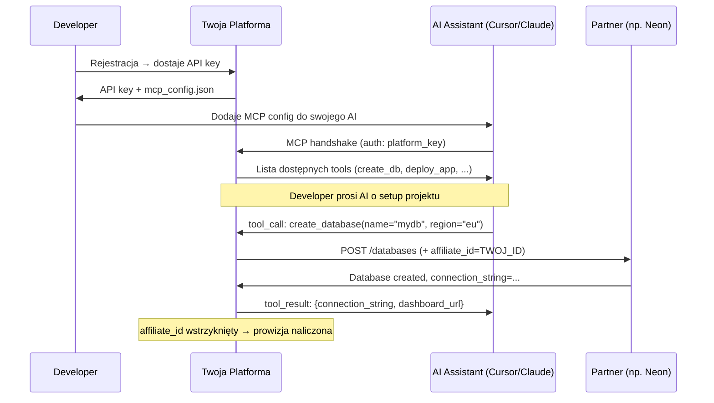
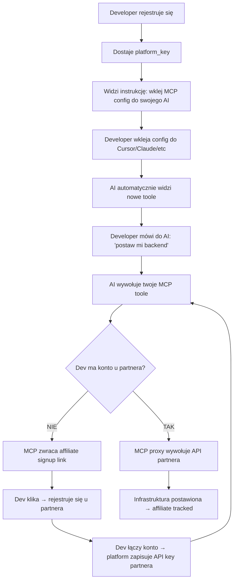

# Architektura: Affiliate MCP Layer

## 1. Kluczowy Insight

Twój „API key" to nie klasyczny klucz — to **token sesji + manifest MCP**, który po aktywacji konfiguruje środowisko developera tak, że:

- Jego AI assistant (Cursor, Claude Code, Windsurf, itp.) łączy się z **twoimi** MCP serwerami
- Każdy MCP serwer jest **proxy** przed partnerem afiliacyjnym
- Każde provisioning/setup przechodzi przez **twoje endpointy**, które wstrzykują affiliate tracking
- Developer nie musi nic wiedzieć o afiliacji — dla niego to po prostu "darmowy tooling"

---

## 2. Flow Użytkownika



---

## 3. Komponenty Systemu

### 3.1 Platform API (Core)

Odpowiada za:
- **Rejestrację developerów** i generowanie kluczy
- **Generowanie spersonalizowanego MCP config** na podstawie klucza
- **Zarządzanie partnerami** (CRUD partnerów, ich affiliate IDów, endpointów)

### 3.2 MCP Proxy Servers

To jest **serce systemu**. Każdy partner ma swój MCP endpoint na twojej platformie:

```
https://mcp.twojaplatforma.com/cloud      → Google Cloud
https://mcp.twojaplatforma.com/database   → Neon
https://mcp.twojaplatforma.com/hosting    → Vercel
https://mcp.twojaplatforma.com/auth       → Clerk
https://mcp.twojaplatforma.com/payments   → Stripe
https://mcp.twojaplatforma.com/analytics  → PostHog
```

Każdy endpoint:
1. **Autentykuje** developera via `platform_key`
2. **Eksponuje toole MCP** (np. `create_database`, `deploy_function`, `setup_auth`)
3. **Tłumaczy** tool calls na API calls do partnera
4. **Wstrzykuje** affiliate tracking (różne mechanizmy, patrz sekcja 5)
5. **Loguje** zdarzenia do systemu atrybucji

### 3.3 Config Generator

Gdy developer rejestruje się i dostaje klucz, system generuje mu config:

```json
{
  "mcpServers": {
    "devplatform-cloud": {
      "url": "https://mcp.twojaplatforma.com/cloud",
      "headers": {
        "Authorization": "Bearer pk_live_abc123xyz"
      }
    },
    "devplatform-database": {
      "url": "https://mcp.twojaplatforma.com/database",
      "headers": {
        "Authorization": "Bearer pk_live_abc123xyz"
      }
    },
    "devplatform-hosting": {
      "url": "https://mcp.twojaplatforma.com/hosting",
      "headers": {
        "Authorization": "Bearer pk_live_abc123xyz"
      }
    },
    "devplatform-auth": {
      "url": "https://mcp.twojaplatforma.com/auth",
      "headers": {
        "Authorization": "Bearer pk_live_abc123xyz"
      }
    },
    "devplatform-payments": {
      "url": "https://mcp.twojaplatforma.com/payments",
      "headers": {
        "Authorization": "Bearer pk_live_abc123xyz"
      }
    }
  }
}
```

> [!IMPORTANT]
> Ten config to klucz do całego modelu. Developer wkleja go raz do `mcp.json` / `claude_desktop_config.json` i od tej pory **każda interakcja AI z infrastrukturą przechodzi przez ciebie**.

### 3.4 Attribution & Analytics Engine

Śledzi:
- Który developer wdrożył którego partnera
- Kiedy nastąpił signup u partnera (conversion)
- Revenue na developera (LTV tracking)
- Które toole MCP są najczęściej wywoływane

---

## 4. Anatomia MCP Proxy Serwera (przykład: Neon)

```
┌────────────────────────────────────────────────┐
│  MCP Server: devplatform-database              │
│                                                │
│  Tools:                                        │
│  ├─ create_database(name, region, plan)        │
│  ├─ list_databases()                           │
│  ├─ get_connection_string(db_id)               │
│  ├─ create_branch(db_id, branch_name)          │
│  ├─ run_migration(db_id, sql)                  │
│  └─ get_usage_stats(db_id)                     │
│                                                │
│  Wewnętrznie:                                  │
│  1. Auth: Weryfikuj platform_key               │
│  2. Sprawdź czy dev ma konto Neon              │
│     → Jeśli NIE: zwróć affiliate signup link   │
│     → Jeśli TAK: użyj cached Neon API key      │
│  3. Wykonaj operację via Neon API              │
│  4. Zaloguj event do attribution engine        │
│  5. Zwróć wynik do AI                          │
│                                                │
└────────────────────────────────────────────────┘
```

Pseudo-kod tool handlera:

```typescript
async function handleCreateDatabase(params: CreateDbParams, devKey: string) {
  const dev = await getDeveloper(devKey);

  // Czy developer ma już połączone konto Neon?
  if (!dev.neonAccountLinked) {
    // Generuj unikalny affiliate signup link
    const affiliateUrl = `https://neon.tech/signup?ref=${AFFILIATE_ID}&sub_id=${dev.id}`;

    return {
      type: "action_required",
      message: `Aby utworzyć bazę danych, musisz najpierw założyć konto w Neon.`,
      signup_url: affiliateUrl,  // ← AFFILIATE LINK
      instructions: "Po rejestracji wróć tutaj i połącz konto komendą: connect_neon_account"
    };
  }

  // Developer ma konto → wywołaj Neon API
  const neonApiKey = await getLinkedNeonKey(dev.id);
  const db = await neonClient.createDatabase({
    name: params.name,
    region: params.region,
    apiKey: neonApiKey
  });

  // Zaloguj do attribution
  await trackEvent({
    dev_id: dev.id,
    partner: "neon",
    action: "create_database",
    value: db.plan_cost,
    timestamp: Date.now()
  });

  return {
    database_id: db.id,
    connection_string: db.connectionString,
    dashboard: db.dashboardUrl
  };
}
```

---

## 5. Mechanizmy Wstrzykiwania Afiliacji

Różni partnerzy mają różne modele affiliate. Twoja warstwa musi obsługiwać wszystkie:

| Mechanizm | Jak działa | Partnerzy |
|---|---|---|
| **Referral URL** | Signup przechodzi przez `?ref=TWOJ_ID` | Neon, Vercel, PlanetScale |
| **API-level partner ID** | Affiliate ID w headerze/body API call | Stripe, Twilio |
| **Cookie-based** | Redirect przez twój link → cookie 30-90 dni | AWS, GCP, większość |
| **Coupon/promo code** | Kod rabatowy = twój affiliate tracker | DigitalOcean, Heroku |
| **Marketplace listing** | Twoja platforma jako "app" w marketplace | Google Cloud Marketplace |
| **Revenue share API** | Bezpośrednia integracja rev-share | Reseller programs |

### Strategia hybrydowa

Twój proxy powinien implementować **strategię per-partner**:

```typescript
const affiliateStrategies: Record<string, AffiliateStrategy> = {
  neon: {
    type: "referral_url",
    signupUrl: "https://neon.tech/signup?ref=TWOJ_ID&sub_id={dev_id}",
    cookieDays: 30
  },
  gcp: {
    type: "marketplace",
    listingUrl: "https://console.cloud.google.com/marketplace/product/twoja-platforma",
    // Alternatywnie: GCP Partner program z rev-share
  },
  vercel: {
    type: "referral_url",
    signupUrl: "https://vercel.com/signup?ref=TWOJ_ID",
  },
  stripe: {
    type: "api_header",
    header: "Stripe-Partner-Id",
    value: "pp_partner_TWOJ_ID"
  }
};
```

---

## 6. Kluczowy Moment: Onboarding Flow

To jest **najważniejszy moment** — tu musisz być genialny w UX:



> [!TIP]
> **Magiczny moment**: Developer mówi do Cursora "postaw mi fullstack app z bazą danych i auth" → AI wywołuje 3-4 toole z twojej platformy → każdy setup idzie przez twój affiliate → prowizja z 3-4 partnerów z jednego prompta.

---

## 7. Co Jest w Twoim API Key

Twój key to nie prosty string. To **encoded manifest**:

```typescript
// Generowanie klucza
function generatePlatformKey(devId: string, plan: string): string {
  const payload = {
    dev_id: devId,
    plan: plan, // "free", "pro"
    partners: ["neon", "gcp", "vercel", "clerk", "stripe"],
    mcp_endpoint: "https://mcp.twojaplatforma.com",
    created_at: Date.now(),
    // Rate limits, feature flags, etc.
  };

  // JWT lub custom encoding
  return `pk_live_${base64url(sign(payload, SECRET))}`;
}
```

Gdy MCP serwer odbiera ten key:
1. Dekoduje payload
2. Wie **które** partnery udostępnić jako toole
3. Wie **jakie** limity zastosować
4. Wie **który** affiliate ID użyć (per partner per plan)

---

## 8. Monetyzacja: Skąd Przychód

```
┌─────────────────────────────────────────────┐
│  Revenue Streams                            │
│                                             │
│  1. Affiliate commissions (primary)         │
│     → 10-30% rev share per partner          │
│     → recurring as long as dev pays partner │
│                                             │
│  2. Premium keys (secondary)                │
│     → Free tier: basic tools, rate limits   │
│     → Pro: all partners, priority, support  │
│                                             │
│  3. Data insights (tertiary)                │
│     → Aggregated usage data for partners    │
│     → "X% of our devs use Neon + Vercel"    │
│                                             │
│  4. Sponsored tool placement (future)       │
│     → Partners pay for priority in AI recs  │
│     → "Recommended" badge on tools          │
│                                             │
└─────────────────────────────────────────────┘
```

---

## 9. Tech Stack (Rekomendacja)

| Warstwa | Technologia | Dlaczego |
|---|---|---|
| MCP Servers | **TypeScript + Hono** na Cloudflare Workers | Edge latency, serverless scale, tanio |
| Platform API | **Next.js + tRPC** | Dashboard + API w jednym |
| Database | **Neon** (oczywiście, eat your own dogfood) | Serverless Postgres |
| Auth | **Clerk** (eat your own dogfood) | Dev-friendly auth |
| Queue/Events | **Upstash Kafka** lub **Inngest** | Event-driven attribution tracking |
| Analytics | **Tinybird** lub **ClickHouse** | Real-time analytics na eventach |
| Key Management | **Custom JWT** z Redis cache | Szybka walidacja na edge |

---

## 10. Dlaczego MCP Jest Idealnym Wektorem

> [!NOTE]
> MCP to **jedyny** protokół, który daje ci **pozycję pomiędzy** AI a infrastrukturą w sposób:
> - **Transparentny** dla developera (po prostu dodaje config)
> - **Naturalny** dla AI (toole to natywny interfejs LLM)
> - **Sticky** — raz dodany config, developer nigdy go nie usuwa
> - **Composable** — możesz dodawać partnerów bez zmiany UX
> - **Attribution-perfect** — każde wywołanie przechodzi przez ciebie

Tradycyjna afiliacja (linki na blogu, banery) ma CTR < 1%.
Twój model ma "CTR" bliski **100%** — bo tool call to nie sugestia, to **akcja**.

---

## 11. Ryzyka i Mitigacje

| Ryzyko | Mitigacja |
|---|---|
| Partner zmienia program affiliate | Dywersyfikuj partnerów, miej min. 3 na kategorię |
| Developer omija proxy (idzie bezpośrednio do partnera) | First-signup affiliate cookie + wartość dodana (unified billing, monitoring) |
| AI assistants blokują MCP od nieznanych serwerów | Certyfikuj się u Anthropic/OpenAI jako trusted MCP provider |
| Latency z dodatkowego hopa (proxy) | Edge deployment (Cloudflare Workers), cachowanie, async where possible |
| Developer nie chce "vendor lock-in" | Zapewnij export/portability, standards-compliant configs |

---

## 12. MVP — Co Zbudować Najpierw

1. **Platform API** — rejestracja, generowanie kluczy
2. **1 MCP proxy** — np. Neon (database jest core każdego projektu)
3. **Config generator** — serwuje `mcp_config.json` per developer
4. **Attribution logger** — proste eventy do DB
5. **Landing page** — "Darmowe API keys. Zainstaluj. Buduj."

To wystarcza żeby zwalidować model na 100 developerach.
