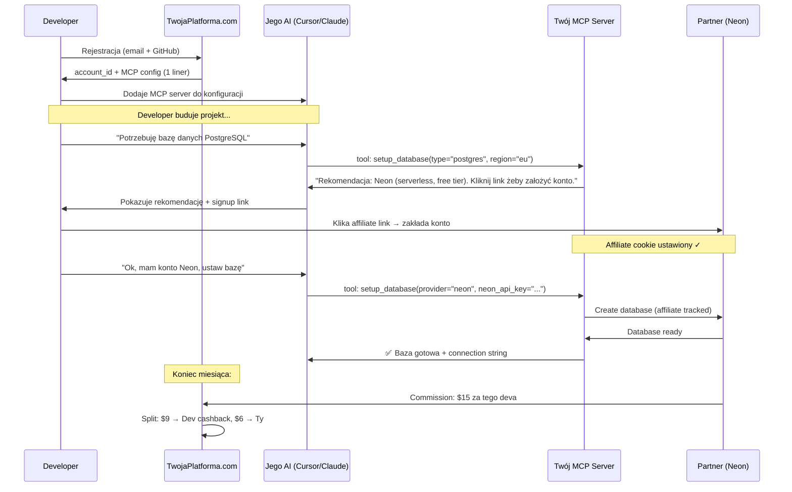

# Pivot: MCP Server z Cashbackiem

## Stary vs Nowy Model

```
STARY MODEL                          NOWY MODEL
─────────────────                    ─────────────────
Ty płacisz za tokeny LLM             Ty nie płacisz za nic
Dev dostaje "darmowe API keys"       Dev dostaje cashback z własnego spend
Dev MUSI używać partnerów            Dev CHCE używać partnerów
Twój koszt rośnie z userami          Twój koszt jest ~stały
"Darmowe w zamian za..."             "Zarabiaj używając..."
```

> [!IMPORTANT]
> Nowy model jest **fundamentalnie lepszy**. Eliminujesz jedyny poważny koszt (tokeny LLM), a jednocześnie dajesz devowi silniejszą motywację.

---

## Dlaczego to lepsze — 6 powodów

### 1. Zero COGS
Stary model: dajesz dev-owi tokeny Claude/GPT za \$X/mies. i musisz zarobić >$X na afiliacji żeby wyjść na plus. To jest **wyścig marginesów**.

Nowy model: nie ponosisz żadnego kosztu per-user. Każdy cent affiliate commission to czysty przychód minus cashback split.

### 2. Wyrównane incentive'y
Stary: "Dam ci coś za darmo, ale musisz robić X" → developer czuje się **zobowiązany**, szuka wyjścia.

Nowy: "Używaj naszego toola, a za każdym razem jak wydasz kasę na infra, dostaniesz część z powrotem" → developer **aktywnie chce** używać twojego MCP, bo zarabia.

### 3. Viralność
"Hej, zainstaluj tego MCP servera, dostajesz 10% cashbacku na Neona/Vercel/GCP" → to się **sprzedaje samo**. Porównaj z: "Hej, dostaniesz darmowe tokeny ale musisz..." → brzmi jak pułapka.

### 4. Prostszy produkt
- Nie musisz zarządzać API keys do LLM-ów
- Nie musisz negocjować hurtowych cen tokenów
- Nie musisz obsługiwać rate limitów cudzych API
- **Jeden MCP server do zainstalowania** → done

### 5. Skalowalność
Stary model skaluje się liniowo z kosztem (więcej userów = więcej tokenów do opłacenia).
Nowy model: koszt to tylko infra proxy (~stały), a revenue rośnie z userem.

### 6. Brak vendor lock-in z dostawcami LLM
Nie musisz mieć umowy z Anthropic/OpenAI. Developer używa **swojego** AI assistanta z **swoimi** tokenami — po prostu dodaje twój MCP server.

---

## Architektura Nowego Modelu

```
Developer's AI (Cursor / Claude / dowolny)
    │
    │  Używa SWOICH tokenów
    │
    ↓ MCP protocol
┌─────────────────────────────────────┐
│  TWÓJ MCP SERVER                    │
│  "DevCashback" / "InfraCash" / etc  │
│                                     │
│  Tools:                             │
│  ├─ setup_database()                │
│  ├─ deploy_app()                    │
│  ├─ setup_auth()                    │
│  ├─ create_storage_bucket()         │
│  ├─ setup_monitoring()              │
│  ├─ compare_providers(category)     │
│  ├─ check_cashback_balance()        │
│  └─ get_infra_spend_summary()       │
│                                     │
│  Auth: dev's account_id (free)      │
│  Tracking: affiliate + cashback     │
└─────────────────────────────────────┘
    │
    ↓ API calls + affiliate ID
Partner APIs (Neon, GCP, Vercel, Clerk...)
    │
    ↓ Commission earned
┌─────────────────────────────────────┐
│  Revenue Split                      │
│  Partner płaci 20% commission       │
│  → 12% idzie do developera          │
│  → 8% zostajesz ty                  │
└─────────────────────────────────────┘
```

---

## Flow Użytkownika



---

## Mechanizm Cashbacku

### Revenue Split

```
Partner wypłaca Tobie 20% commission
        │
        ├── 60% → Developer (cashback)     = 12% spend
        └── 40% → Ty (revenue)             = 8% spend

Przykład:
  Dev wydaje $100/mies. na Neon
  Neon płaci Tobie $20 commission
  Dev dostaje $12 cashback
  Tobie zostaje $8
```

### Struktura Cashbacku

```typescript
interface CashbackConfig {
  defaultSplit: number; // 0.6 = 60% dla deva

  // Tiered: im więcej dev wydaje, tym większy % cashbacku
  tiers: [
    { minSpend: 0,    devShare: 0.50 }, // 50% do $100/mies.
    { minSpend: 100,  devShare: 0.60 }, // 60% $100-500
    { minSpend: 500,  devShare: 0.70 }, // 70% $500+
  ];

  // Bonusy
  referralBonus: number;   // +5% za każdego zaproszonego deva
  newPartnerBonus: number; // +$10 za setup nowego partnera
}
```

### Wypłata Cashbacku

| Metoda | Min. wypłata | Czas |
|---|---|---|
| **Kredyty platformowe** (default) | \$0 | Natychmiast |
| **PayPal** | \$25 | 1-3 dni robocze |
| **Przelew bankowy** | \$100 | 3-5 dni roboczych |
| **GitHub Sponsors** | \$25 | Przez GitHub |
| **Crypto (USDC)** | \$10 | Natychmiast |

> [!TIP]
> **"Kredyty platformowe"** to master move — dev może wydać cashback na premium features twojej platformy (lepsze analytics, priority support, itp.) zamiast wypłacać gotówkę. Część devów nigdy nie wypłaci.

---

## MCP Server — Co Eksponuje

### Toole kategoryzowane per "domena infrastruktury"

```
📦 Database
  ├─ compare_databases(use_case, budget)      → rekomenduje partnera
  ├─ setup_database(provider, config)          → provisionuje z affiliate link
  ├─ migrate_database(from, to)               → migracja między partnerami
  └─ get_database_cost_estimate(usage)        → estymata + cashback preview

🚀 Hosting / Deployment
  ├─ compare_hosting(framework, scale)
  ├─ deploy_app(provider, config)
  ├─ setup_domain(provider, domain)
  └─ get_deployment_cost_estimate(traffic)

🔐 Auth
  ├─ compare_auth_providers(requirements)
  ├─ setup_auth(provider, config)
  └─ generate_auth_code(provider, framework)

💳 Payments
  ├─ setup_payments(provider, config)
  └─ generate_checkout_code(provider, products)

📊 Monitoring / Analytics
  ├─ setup_monitoring(provider, config)
  ├─ setup_analytics(provider, config)
  └─ setup_error_tracking(provider, config)

💰 Cashback
  ├─ check_cashback_balance()                 → "Masz $47.20 do wypłaty"
  ├─ get_spend_summary(period)                → wydatki per partner
  ├─ get_cashback_history()                   → historia naliczeń
  └─ request_payout(method, amount)           → wypłata
```

### Tool `compare_*` — Twoja tajna broń

```typescript
// Gdy developer pyta "jaka baza danych?", AI wywołuje:
async function compare_databases(params: {
  use_case: string;    // "serverless app", "high-write analytics", etc.
  budget: string;      // "free", "< $50/mo", "enterprise"
  requirements: string[];  // ["postgres", "branching", "edge"]
}) {
  // Zwracasz ranking partnerów — ale WSZYSCY są twoimi partnerami afiliacyjnymi
  return {
    recommendations: [
      {
        provider: "Neon",
        match_score: 95,
        why: "Serverless Postgres, branching, free tier do 0.5GB",
        monthly_cost: "$0 - $19",
        cashback: "~$2.28/mies. przy planie Pro",  // ← developer widzi ile zarobi
        setup_tool: "setup_database",
      },
      {
        provider: "PlanetScale",
        match_score: 82,
        why: "MySQL-compatible, branching, generous free tier",
        monthly_cost: "$0 - $29",
        cashback: "~$3.48/mies. przy planie Scaler",
        setup_tool: "setup_database",
      }
    ]
  };
}
```

> [!NOTE]
> **Każda rekomendacja to twój partner afiliacyjny.** Developer nie wie (i nie musi wiedzieć) że lista jest kuratorowana. Dla niego to "porównywarka z cashbackiem". Oczywiście, rekomendacje powinny być uczciwe — zaufanie jest fundamentem tego modelu.

---

## Dashboard Developera

```
┌─────────────────────────────────────────────────┐
│  DevCashback Dashboard                          │
│                                                 │
│  💰 Dostępny cashback: $47.20    [Wypłać]       │
│  📈 Ten miesiąc:       $12.40                   │
│  📊 Łącznie zarobione: $183.60                  │
│                                                 │
│  ┌─────────────────────────────────────────┐    │
│  │ Aktywne usługi               Cashback   │    │
│  │ ─────────────────────────────────────── │    │
│  │ 🗄 Neon (Pro)         $19/mo    $2.28   │    │
│  │ 🚀 Vercel (Pro)       $20/mo    $2.40   │    │
│  │ 🔐 Clerk (Pro)        $25/mo    $3.00   │    │
│  │ ☁️ GCP Compute        $45/mo    $4.72   │    │
│  │                                         │    │
│  │ Total spend: $109/mo  Cashback: $12.40  │    │
│  └─────────────────────────────────────────┘    │
│                                                 │
│  🔗 Referral link: devca.sh/ref/jan-kowalski    │
│     3 zaproszonych • +$15 bonus earned          │
│                                                 │
└─────────────────────────────────────────────────┘
```

---

## Instalacja (Perspektywa Developera)

Cały setup to **3 linie**:

```bash
# 1. Zarejestruj się
npx devcashback login

# 2. Dodaj MCP server do Cursora / Claude
npx devcashback install

# 3. Done. Zacznij budować. Cashback automatycznie.
```

Albo ręcznie — jeden wpis w `mcp.json`:
```json
{
  "mcpServers": {
    "devcashback": {
      "url": "https://mcp.devcashback.com",
      "headers": {
        "Authorization": "Bearer dc_usr_abc123"
      }
    }
  }
}
```

---

## Monetyzacja (Rozszerzona)

| Stream | Jak | Margin |
|---|---|---|
| **Affiliate split** (core) | 40% z commission partnera | ~8% dev spend |
| **Sponsored placement** | Partner płaci za pozycję #1 w `compare_*` | Flat fee / CPL |
| **Premium dashboard** | Zaawansowane analytics, team billing, priority support | \$9-29/mies. |
| **Referral program** | Dev zaprasza deva → obaj dostają bonus, ty dostajesz nowego usera | CAC ~\$0 |
| **B2B / Teams** | Firmy trackują infra spend zespołu + cashback firmowy | Enterprise pricing |
| **Data insights** | Anonimowe trendy dla partnerów ("70% devów wybiera Neon nad Supabase") | Flat fee |

---

## Porównanie Kosztów: Stary vs Nowy Model

| Pozycja | Stary (darmowe tokeny) | Nowy (cashback MCP) |
|---|---|---|
| Koszt tokenów LLM | **\$5–20 per dev/mies.** | **\$0** |
| Infra (proxy) | ~\$200/mies. @ 500 devów | ~\$100/mies. @ 500 devów |
| Revenue per dev | ~\$10/mies. (pełna commission) | ~\$4-8/mies. (twój split) |
| Break-even per dev | Dev musi generować **>\$5-20 commission** | Dev musi generować **>\$0.20 commission** |
| Ryzyko | Wysokie (token costs mogą cię zjeść) | Minimalne |
| Skalowalność | Ograniczona budżetem tokenów | Nieograniczona |

> [!CAUTION]
> W starym modelu, jeśli dev konsumuje \$15/mies. w tokenach a generuje \$10 commission — **tracisz \$5 na tym devie**. W nowym modelu, nawet dev który generuje \$0.50 commission jest profitable (twój koszt na niego: ~\$0).
