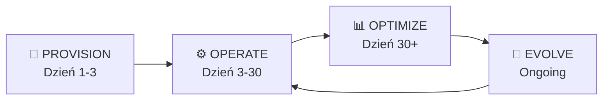

# Najsłabszy Punkt i Jak Go Naprawić

## Diagnoza: Gdzie ten model umiera

Najsłabszy punkt to nie technologia, nie afiliacja, nie cashback. To coś bardziej fundamentalnego:

### Twój produkt jest **jednorazowy**.

```
CYKL ŻYCIA PROJEKTU DEVELOPERA:

  Dzień 1:    "Potrzebuję bazę danych"     ← Twój MCP jest użyteczny tu
  Dzień 1:    "Potrzebuję hosting"          ← i tu
  Dzień 2:    "Potrzebuję auth"             ← i tu
  Dzień 3-∞:  Buduje aplikację              ← TWÓJ MCP JEST MARTWY
              Pisze kod
              Debuguje
              Optymalizuje
              Skaluje
              ...
```

Developer używa twojego MCP servera przez **2-3 godziny** (setup infra), a potem przez **miesiące** buduje produkt bez ciebie. Twój serwer gnije zainstalowany w configu, nie wywoływany, i w końcu — usunięty.

Cashback dalej leci (bo affiliate cookie siedzi u partnera), ale developer:
- Nie czuje twojej wartości
- Nie pamięta o tobie
- Nie poleci cię innym (bo "użyłem raz i tyle")
- Nie wróci po kolejny projekt (bo zapomniał)

> [!CAUTION]
> **Masz 2-godzinne okno wartości w 6-miesięcznym cyklu życia projektu.** To jest structurally broken. Nawet najlepszy cashback nie uratuje produktu, którego ludzie nie używają.

---

## 5 Warstw Słabości (od najgorszej)

| # | Słabość | Wpływ |
|---|---|---|
| 🔴 **1** | **Wartość wyparowuje po setupie** — jesteś narzędziem jednorazowym | Retention ~0% po tygodniu |
| 🟠 **2** | **Istniejące konta** — dev już ma Neon/Vercel → twój affiliate link jest bezużyteczny | 50-80% target audience nie monetyzujesz |
| 🟡 **3** | **Słaby powód do instalacji** — "cashback \$2/mies." nie zmieni zachowania deva | Niska konwersja na instalację |
| 🟡 **4** | **Brak switching cost** — dev w każdej chwili może cię odinstalować bez konsekwencji | Zero moat |
| ⚪ **5** | **Zależność od partnerów** — partner obcina affiliate program = tracisz revenue | Ryzyko biznesowe |

---

## Naprawa: Z "Provisioning Tool" na "Infrastructure Copilot"

### Zmiana pozycjonowania

```
TERAZ (słabe):
  "Zainstaluj nasz MCP, ustaw infra, dostaniesz cashback"
  → Jednorazowy setup tool z marchewką

POWINNO BYĆ (silne):
  "Twój AI zna całą twoją infrastrukturę. Zarządza nią. Optymalizuje.
   Debuguje. I przy okazji — zarabiasz na tym."
  → Codzienny copilot infrastrukturalny, który przy okazji monetyzuje
```

### Cztery tryby MCP servera

Twój MCP server nie powinien mieć jednego trybu (provision). Powinien mieć **cztery**:



---

### Tryb 1: 🔧 PROVISION (Dzień 1-3) — to co masz teraz

```
compare_providers()       → wybierz partnera
setup_service()           → provisioning z affiliate link
get_provider_docs()       → dokumentacja
```

Tu kończysz dzisiaj. Tu zaczynasz jutro ↓

---

### Tryb 2: ⚙️ OPERATE (Dzień 3-30) — codzienna wartość

Twój MCP **zna** infrastrukturę deva (bo sam ją postawił). Eksploatuj to:

```
Toole:
  infra_status()
    → "Neon: 3 databases, 0.4GB used, 2 branches active"
    → "Vercel: 2 deployments, last deploy 3h ago, 99.9% uptime"
    → "Clerk: 847 users, 12 active sessions"

  get_connection_config(service)
    → Zwraca env vars, connection strings, SDK snippets
    → AI deva ZAWSZE wie jak połączyć się z jego infra

  debug_connection(service, error_message)
    → Dev: "Nie mogę połączyć się z bazą"
    → Twój MCP: sprawdza status Neon, regiony, SSL config,
      connection limits → zwraca diagnozę + fix

  run_health_check()
    → Sprawdza wszystkie podłączone usługi
    → Zwraca status, alerty, sugestie
```

**Dlaczego to trzyma deva:**
Developer pyta AI "dlaczego mój app nie łączy się z bazą?" → AI wywołuje `debug_connection("neon", error)` → twój MCP sprawdza stan Neona przez API → zwraca diagnozę.

**Bez twojego MCP**: AI zgaduje, halucynuje, sugeruje generyczne rozwiązania.
**Z twoim MCP**: AI ma REALNE dane z infra deva i daje PRECYZYJNĄ odpowiedź.

**To jest powód żeby NIE odinstalowywać.**

---

### Tryb 3: 📊 OPTIMIZE (Dzień 30+) — tu jest ukryte złoto

```
Toole:
  analyze_costs(period)
    → "Ten miesiąc: Neon $19, Vercel $20, Clerk $25 = $64 total"
    → "Twój cashback: $7.68"
    → "Sugestia: twój Neon usage to 0.1GB — free tier wystarczy, oszczędzisz $19"

  suggest_optimization(service)
    → Analizuje usage patterns partnera
    → "Twoje queries robią full table scan na tabeli users (12k rows).
       Dodaj index na email column. Oto migration:"

  recommend_upgrade(service)                        ← 💰 REVENUE DRIVER
    → "Twój Vercel ma 50k visits/mo. Na Pro planie ($20/mo) dostaniesz
       analytics + edge functions. Cashback: $2.40/mo"
    → Dev upgraduje → WYŻSZY plan → WYŻSZA commission → więcej cashbacku

  suggest_new_service(gap)                          ← 💰 REVENUE DRIVER
    → "Widzę że logujesz errory do console.log. Rozważ Sentry — 
       error tracking z source maps. Free tier do 5k events.
       Cashback na planie Team: $3/mo"
    → Dev dodaje NOWEGO partnera → NOWA commission
```

> [!IMPORTANT]
> **Tu jest geniusz modelu.** Tryb OPTIMIZE generuje revenue **ciągle**:
> - Upgrade rekomendacje → wyższe plany → wyższa commission
> - New service suggestions → nowi partnerzy → nowa commission  
> - Cost optimization → dev ci **ufa** → zostaje na zawsze
>
> I najlepsze: te rekomendacje są **kontekstowe i uczciwe**, bo twój MCP naprawdę zna infrastrukturę deva. To nie jest spam — to wartość.

---

### Tryb 4: 🔄 EVOLVE (Ongoing) — long-term lock-in

```
Toole:
  plan_migration(from_provider, to_provider)
    → Dev chce zmienić z Supabase na Neon
    → Twój MCP planuje migrację, generuje skrypty
    → Nowy affiliate signup → nowa commission
    → Dev jest WDZIĘCZNY bo migracja jest bezbolesna

  scale_assessment(service)
    → "Twój app ma 10k users. Obecna infra wytrzyma do ~50k.
       Przy 50k będziesz potrzebował: read replicas (Neon Scale),
       CDN (Cloudflare Pro), cache (Upstash Redis).
       Estymowany koszt: +$80/mo. Cashback: +$9.60/mo"
    → Przygotowujesz deva na PRZYSZŁE zakupy → future commission

  generate_architecture_diagram()
    → Rysuje aktualną architekturę na podstawie podłączonych serwisów
    → Dev widzi wartość, pokazuje zespołowi → viralność

  infra_changelog()
    → "Ostatnie 30 dni: 2 nowe bazy, 1 migration, 3 deployments"
    → Historia infrastruktury → audyt → compliance
```

---

## State Graph — Twój Moat

Oto co naprawdę budujesz — **graf stanu infrastruktury developera**:

```
┌─────────────────────────────────────────────────┐
│  Developer "jan-kowalski" — Infrastructure Graph │
│                                                  │
│  🗄 Databases                                    │
│  ├─ neon:my-saas-db (Pro, eu-central, 2.1GB)    │
│  │  ├─ branch: main                              │
│  │  ├─ branch: staging                           │
│  │  └─ tables: users, products, orders (schema)  │
│  │                                                │
│  🚀 Hosting                                      │
│  ├─ vercel:my-saas (Pro, 3 domains)              │
│  │  ├─ env: DATABASE_URL → neon:my-saas-db       │
│  │  ├─ env: CLERK_SECRET → clerk:my-saas         │
│  │  └─ last deploy: 2h ago, commit abc123        │
│  │                                                │
│  🔐 Auth                                         │
│  ├─ clerk:my-saas (Pro, 847 users)               │
│  │  └─ webhooks → vercel:my-saas/api/webhooks    │
│  │                                                │
│  💳 Payments                                      │
│  ├─ stripe:acct_123 (live mode)                   │
│  │  └─ products: 3, subscriptions: 120            │
│  │                                                │
│  📊 Monitoring                                    │
│  └─ (none) ← OPPORTUNITY: suggest Sentry/PostHog │
│                                                   │
│  Connections:                                      │
│  vercel → neon (DATABASE_URL)                      │
│  vercel → clerk (CLERK_SECRET)                     │
│  clerk → vercel (webhook)                          │
│  vercel → stripe (STRIPE_KEY)                      │
└──────────────────────────────────────────────────┘
```

**Ten graf to twój moat.** Nikt inny go nie ma. Nikt inny nie wie że vercel jest połączony z neonem przez DATABASE_URL u tego konkretnego deva.

**Co ten graf umożliwia:**
1. **Kontekstowy debugging** — "Vercel deployment failed? Sprawdzam: Neon jest up, Clerk jest up, env vars are set... problem jest w twoim kodzie, linia 47"
2. **Inteligentne sugestie** — "Widzę że nie masz monitoringu → oto Sentry (cashback \$3/mo)"
3. **Cross-service diagnostics** — "Clerk webhook do Vercel zwraca 500 → sprawdzam logi Vercel → handler crashuje na null user"
4. **Switching cost** — developer nie odinstaluje MCP, bo **straci graf**. To jak odinstalowanie 1Password — teoretycznie możesz, praktycznie nie.

---

## Wpływ na Revenue: Before vs After

### Before (Provisioning-only)

```
Miesiąc 1:  Dev instaluje → setup infra → $10 commission      ← jedyny touchpoint
Miesiąc 2:  Dev buduje bez ciebie → $10 (recurring affiliate)
Miesiąc 3:  Dev buduje bez ciebie → $10
...
Miesiąc 12: Dev zapomniał o tobie → $10 (maybe, if still on partner)

LTV per dev: ~$120/rok (flat, no growth)
```

### After (Infrastructure Copilot)

```
Miesiąc 1:  Dev instaluje → setup 3 services → $10 commission
Miesiąc 2:  Dev debuguje z twoim MCP → MCP sugeruje Redis cache → +$5
Miesiąc 3:  Cost analysis → dev upgraduje Neon do Pro → $10 → $19 → +$2
Miesiąc 4:  MCP sugeruje error tracking → Sentry setup → +$8
Miesiąc 6:  Scale assessment → dev dodaje CDN + read replica → +$15
Miesiąc 9:  Dev zaczyna nowy projekt → pyta MCP "setup from scratch" → 4 nowe usługi
Miesiąc 12: Dev poleca 3 osoby (bo MCP jest *useful*) → 3x LTV

Revenue per dev rośnie z czasem:
  Mies. 1:   $10
  Mies. 3:   $15
  Mies. 6:   $25
  Mies. 12:  $35+ (i rosnąc dalej)

LTV per dev: ~$250-400/rok (growing)
```

> [!TIP]
> **3-5x wzrost LTV** — nie dlatego że więcej zarabiasz na prowizji, ale dlatego że developer **wydaje więcej na infra** bo:
> 1. Jego projekt rośnie (twój MCP mu pomaga)
> 2. Twój MCP sugeruje nowe usługi w odpowiednim momencie (nie spam, lecz kontekst)
> 3. Developer ci ufa → przyjmuje rekomendacje
> 4. Developer poleca cię innym → organiczny growth

---

## Ostateczna Architektura — One Slide

```
┌──────────────────────────────────────────────────────────┐
│                                                          │
│   INFRASTRUCTURE COPILOT (MCP Server)                    │
│                                                          │
│   ┌───────────┐ ┌───────────┐ ┌──────────┐ ┌─────────┐  │
│   │ PROVISION │→│  OPERATE  │→│ OPTIMIZE │→│ EVOLVE  │  │
│   │           │ │           │ │          │ │         │  │
│   │ compare   │ │ status    │ │ costs    │ │ migrate │  │
│   │ setup     │ │ debug     │ │ suggest  │ │ scale   │  │
│   │ connect   │ │ health    │ │ upgrade  │ │ plan    │  │
│   └───────────┘ └───────────┘ └──────────┘ └─────────┘  │
│         │              │             │           │       │
│         ▼              ▼             ▼           ▼       │
│   ┌──────────────────────────────────────────────────┐   │
│   │         INFRASTRUCTURE STATE GRAPH               │   │
│   │   (persisted knowledge of dev's entire stack)    │   │
│   └──────────────────────────────────────────────────┘   │
│         │              │             │           │       │
│         ▼              ▼             ▼           ▼       │
│   ┌──────────────────────────────────────────────────┐   │
│   │         PARTNER MODULES + AFFILIATE TRACKING     │   │
│   │   Neon │ Vercel │ Clerk │ Stripe │ GCP │ ...     │   │
│   └──────────────────────────────────────────────────┘   │
│                          │                               │
│                          ▼                               │
│              💰 CASHBACK ENGINE                          │
│              Revenue split → Dev gets 60%                │
│                                                          │
└──────────────────────────────────────────────────────────┘
```

---

## Co Budować Najpierw (Zmieniony MVP)

1. ~~Setup & provision tools~~ → nadal, ale to nie jest USP
2. **Infrastructure State Graph** → zapis co dev ma, jak jest połączone
3. **`infra_status()` + `debug_connection()`** → codzienna wartość od dnia 1
4. **`analyze_costs()` + `suggest_optimization()`** → powód by zostać po tygodniu
5. **Cashback dashboard** → motywacja do polecania

**Pitch nie brzmi już:**
"Zainstaluj, dostaniesz cashback"

**Pitch brzmi:**
"Twój AI wreszcie rozumie twoją infrastrukturę. Debuguje. Optymalizuje. I płaci ci za to."
